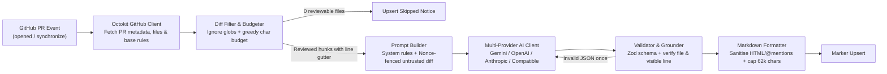

# AI Pull Request Reviewer

A reusable, provider-agnostic and language-agnostic GitHub Action (`node24`, bundled TypeScript ESM) that reviews pull request diffs using **any AI provider** (Google Gemini, OpenAI, Anthropic Claude, OpenRouter, Groq, DeepSeek, Mistral, Together, Azure, or local Ollama/vLLM) and upserts a single structured, advisory review comment per pull request.

---

## Supported AI Providers

| Provider (`provider`) | Default Model | Supported Models / Endpoints |
| :--- | :--- | :--- |
| `gemini` | `gemini-3.8-flash` | `gemini-3.8-flash`, `gemini-4-argon`, `gemini-4-hydrogen`, or any Google Gemini model via `@google/genai` |
| `openai` | `gpt-4.1-mini` | `gpt-4.1`, `gpt-4.1-mini`, `gpt-4o`, `o3-mini`, `o4-mini`, or any OpenAI Chat Completions model |
| `anthropic` | `claude-sonnet-4-20250514` | `claude-sonnet-4-20250514`, `claude-3-7-sonnet-latest`, `claude-3-5-haiku-latest`, etc. |
| `openai-compatible` | `gpt-4.1-mini` | Any OpenAI-compatible `/v1/chat/completions` endpoint via `base_url` (OpenRouter, DeepSeek, Groq, Together, Mistral, Fireworks, LiteLLM, vLLM, Ollama) |
| `auto` *(default)* | Auto-selected | Automatically detects the provider from `model`, `base_url`, or `api_key` prefix |

---

## ⚠️ Data Privacy & Tier Notice

> **AI Provider Data Governance:**
> - **Free / Consumer Tiers:** Many AI providers log prompts and responses (which include your PR diffs and source code) on free tiers to train or improve models. **Do not use a free-tier API key on private or proprietary repositories.**
> - **Paid / Enterprise API Tiers:** Always provision a billing-enabled API key whose terms guarantee zero training on customer API payloads when reviewing private or proprietary codebases.

---

## Architecture



### Key Characteristics
- **Works with any AI provider:** Switch between Gemini, OpenAI, Anthropic Claude, OpenRouter, DeepSeek, Groq, or self-hosted Ollama/vLLM by changing `model` (and optionally `provider` / `base_url`).
- **Zero checkout required:** Fetches PR metadata, changed files, and base-branch review guidelines exclusively through the GitHub REST API. Untrusted PR code is never checked out or executed.
- **Single-comment upsert:** Identifies its own bot comment via a hidden HTML marker and updates it in place on subsequent commits.
- **Line-number grounding:** Diffs are annotated with explicit new-file line numbers (`42 + | const x = 1;`). Every model finding is verified against the reviewed file set and visible hunk lines:
  - Findings referencing files outside the reviewed diff are discarded.
  - Findings referencing line numbers outside the visible diff hunks have their line reset to `null` (kept as file-level findings).
- **Prompt-injection isolation:** System instructions and trusted repository guidelines live exclusively in the system prompt. Untrusted PR titles, descriptions, file paths, and patches are isolated in the user turn inside random per-run nonce delimiters (`<<UNTRUSTED_DATA_<nonce>:...>>`).

---

## Quick Start

1. Add your AI provider's API key as a repository secret named `AI_API_KEY` (**Settings → Secrets and variables → Actions**).
2. Create `.github/workflows/ai-pr-review.yml`:

```yaml
name: AI PR Review

on:
  pull_request:
    types: [opened, synchronize, reopened, ready_for_review]

permissions:
  contents: read
  pull-requests: write

concurrency:
  group: ai-pr-review-${{ github.event.pull_request.number }}
  cancel-in-progress: true

jobs:
  review:
    name: AI Code Review
    if: ${{ !github.event.pull_request.draft }}
    runs-on: ubuntu-latest
    steps:
      - name: Run AI PR Reviewer
        uses: Joseph-Monakedi/PullReviewer@v1
        with:
          api_key: ${{ secrets.AI_API_KEY }}
          model: gemini-3.8-flash # or gpt-4.1-mini, claude-sonnet-4-20250514, etc.
```

### Provider Configuration Examples

#### Google Gemini
```yaml
      - uses: Joseph-Monakedi/PullReviewer@v1
        with:
          provider: gemini
          api_key: ${{ secrets.GEMINI_API_KEY }}
          model: gemini-3.8-flash
```

#### OpenAI
```yaml
      - uses: Joseph-Monakedi/PullReviewer@v1
        with:
          provider: openai
          api_key: ${{ secrets.OPENAI_API_KEY }}
          model: gpt-4.1-mini # or gpt-4.1, o3-mini, o4-mini
```

#### Anthropic Claude
```yaml
      - uses: Joseph-Monakedi/PullReviewer@v1
        with:
          provider: anthropic
          api_key: ${{ secrets.ANTHROPIC_API_KEY }}
          model: claude-sonnet-4-20250514
```

#### OpenRouter / DeepSeek / Groq / Mistral / Custom Gateway
```yaml
      - uses: Joseph-Monakedi/PullReviewer@v1
        with:
          provider: openai-compatible
          base_url: https://openrouter.ai/api/v1 # or https://api.deepseek.com/v1, https://api.groq.com/openai/v1
          api_key: ${{ secrets.OPENROUTER_API_KEY }}
          model: deepseek/deepseek-r1
```

#### Local Ollama / vLLM (Self-Hosted Runner, No API Key Needed)
```yaml
      - uses: Joseph-Monakedi/PullReviewer@v1
        with:
          provider: openai-compatible
          base_url: http://localhost:11434/v1
          model: qwen2.5-coder:32b
```

3. *(Optional)* Add project-specific review rules in `.github/ai-review.md` (or `.github/gemini-review.md`) on your default/base branch. The action reads this file from the **base branch** (`base.sha`) so pull requests cannot tamper with their own review rules.

---

## Configuration

### Inputs

| Input | Default | Required | Description |
| :--- | :--- | :---: | :--- |
| `provider` | `auto` | No | `auto`, `gemini`, `openai`, `anthropic`, or `openai-compatible`. |
| `api_key` | — | **Yes*** | API key for the chosen provider (*optional only when `base_url` is `localhost`). |
| `gemini_api_key` | — | No | Backwards-compatible alias for `api_key`. |
| `base_url` | `""` | No | Custom base URL for OpenRouter, Ollama, vLLM, LiteLLM, Azure, or self-hosted proxies. |
| `github_token` | `${{ github.token }}` | No | GitHub token with `contents: read` and `pull-requests: write`. |
| `model` | `gemini-3.8-flash` | No | Model ID (defaults per provider when `provider` is set explicitly). |
| `max_files` | `50` | No | Maximum number of files (after ignore filters) to review (`1`–`3000`). |
| `max_diff_chars` | `100000` | No | Total annotated diff character budget (`1000`–`2000000`, ~25k tokens at default). |
| `max_findings` | `20` | No | Maximum number of findings rendered in the comment (`1`–`100`). |
| `review_language` | `English` | No | Natural language used for the summary and findings. |
| `custom_instructions` | `""` | No | Trusted inline instructions from the workflow file (max 10,000 chars). |
| `instructions_file` | `.github/ai-review.md` | No | Path to repo guidelines read from the **base branch** (falls back to `.github/gemini-review.md`; `none` disables). |
| `ignore_patterns` | `""` | No | Newline- or comma-separated globs added to defaults (supports `!negation` and `#` comments). |
| `use_default_ignores` | `true` | No | Exclude lockfiles, `dist/`, `build/`, `node_modules/`, minified files, source maps, and binaries. |
| `comment_title` | `AI Code Review` | No | Heading at the top of the review comment. |
| `temperature` | `0.2` | No | Sampling temperature (`0.0`–`2.0`). |
| `fail_on_error` | `true` | No | Fail the workflow step if AI or GitHub calls fail after retries (`false` downgrades to warning). |

### Outputs

| Output | Description |
| :--- | :--- |
| `risk_level` | Overall risk reported by the model (`low`, `medium`, `high`, `critical`). |
| `findings_count` | Number of grounded findings included in the review comment. |
| `comment_id` | ID of the created or updated GitHub issue comment. |
| `comment_url` | HTML URL of the created or updated GitHub issue comment. |
| `reviewed_files` | Count of files included in the review prompt. |
| `excluded_files` | Count of files excluded by ignore patterns, missing patch, `max_files`, or `max_diff_chars`. |

---

## Platform Limitations & Edge Cases

### Fork Pull Requests
GitHub intentionally withholds repository secrets and downgrades `GITHUB_TOKEN` to read-only on `pull_request` workflows triggered from forks.
- When this action detects a fork PR with an empty `api_key`, it emits a workflow notice and **exits cleanly (status 0)** so external contributors are not blocked by a red CI check.
- **Do not use `pull_request_target`** to expose secrets to untrusted fork PRs. To review a fork contribution safely, inspect the diff first and either push the branch to the upstream repository or trigger a maintainer-gated workflow.

### Dependabot Pull Requests
Workflows triggered by Dependabot read secrets from the **Dependabot secrets store**, not the standard Actions secrets store. Add `AI_API_KEY` under **Settings → Secrets and variables → Dependabot** if you want Dependabot PRs reviewed (note that lockfiles are ignored by default unless `use_default_ignores: 'false'` or `!package-lock.json` is configured).

### Large PRs & Binary Files
- GitHub's `pulls.listFiles` endpoint returns at most 3,000 files and omits `patch` for binary files and very large single-file diffs.
- Files without a patch or exceeding `max_files` / `max_diff_chars` are never silently marked as reviewed; every excluded file and its exclusion reason is listed in the collapsible **Review scope** section of the PR comment.

---

## Security Design

1. **No Untrusted Code Execution:** The action operates purely over the GitHub API without `actions/checkout` or installing PR dependencies.
2. **Secret Redaction:** `api_key`, `gemini_api_key`, and `github_token` are passed to `core.setSecret` immediately on startup and scrubbed via `redact()` (along with regex patterns for `AIza*`, `sk-*`, `sk-ant-*`, `sk-or-*`, `gsk_*`, `hf_*`, `ghp_*`, `github_pat_*`, auth headers, and URL query keys) before any error or log message is emitted.
3. **Prompt-Injection Defences:**
   - System rules and trusted instructions are placed strictly in the system prompt.
   - All PR-supplied text is wrapped in per-run random nonce tags (`<<UNTRUSTED_DATA_<nonce>:...>>`), with any colliding substrings escaped.
   - `instructions_file` is fetched at `base.sha`, never `head.sha`.
   - No model tools, function calling, or code execution are enabled.
4. **Output Sanitisation:** All model output rendered into GitHub Markdown has raw HTML escaped (`<` / `>`), `@mentions` and `#123` references neutralised with a zero-width joiner to prevent notification spam, remote images (``) and external links stripped, and code excerpts wrapped in dynamically lengthened backtick fences.

---

## Local Development

Requires **Node.js ≥ 24**.

```bash
npm install
npm run typecheck   # tsc --noEmit
npm test            # vitest run
npm run coverage    # vitest run --coverage
npm run build       # bundles src/index.ts -> dist/index.js via esbuild
npm run all         # typecheck + test + build
```
